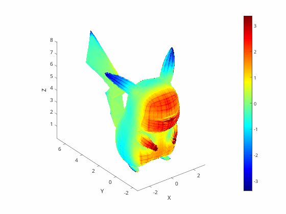
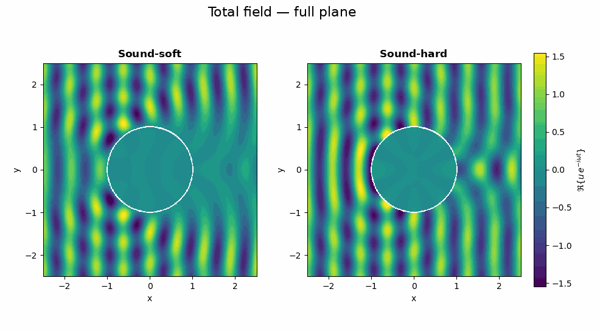

  <canvas id="hero-waves" class="home-hero__canvas" width="960" height="320"
          data-field="/images/hero/field.png" data-cx="0.625" data-cy="0.5" data-r="0.0833"
          role="img" aria-label="Animation of a plane acoustic wave scattered by a sound-soft disk"></canvas>
  

    
Numerical analysis · Wave propagation

    
Simulating how waves scatter

    
Boundary integral equations, BEM and VEM/BEM coupling for acoustic scattering problems.

  

  
Exact solution: plane wave hitting a sound-soft disk

Hi! I'm Davide Collato, a PhD student in Mathematical Sciences at [Politecnico di Torino](https://www.polito.it/) (Department of Mathematical Sciences "G. L. Lagrange"), where I work with Prof. Silvia Falletta and Prof. Letizia Scuderi on *Advanced numerical methods for wave propagation problems*.

I design and analyse numerical methods to simulate how **acoustic waves propagate and scatter** around obstacles. My main tools are **boundary integral equations** and the **Boundary Element Method (BEM)**, which I couple with the **Virtual Element Method (VEM)** to handle complex geometries and general polytopal meshes while keeping the computational cost under control.

I earned my MSc in Mathematics *cum laude* (2024) and my BSc (2022) at the University of Milano-Bicocca. During my PhD I have been a visiting researcher at [ONERA](https://www.onera.fr/en) in Toulouse, and I teach Numerical Linear Algebra for the BSc in Aerospace Engineering at Politecnico di Torino. More in my [CV](/cv/), or get in touch by [email](mailto:davide.collato@polito.it).

## News



## Research Interests

- Numerical approximation of integral equations
- Boundary Integral Equations and the Boundary Element Method (BEM)
- Coupling between the Virtual Element Method (VEM) and BEM
- Wave propagation and acoustic scattering problems
- Partial Differential Equations and their numerical approximation

## Numerical Simulations

  

    

      

        
        
VEM-BEM coupling in 3D

      

      

        
        
Sound-soft acoustic scattering by a Pikachu obstacle

      

      

        
        
Acoustic scattering by a disk: sound-soft vs sound-hard obstacle

      

    

  

  

    <a class="sim-btn" id="simPrev">&#10094;</a>
    
    
    
    <a class="sim-btn" id="simNext">&#10095;</a>
  

